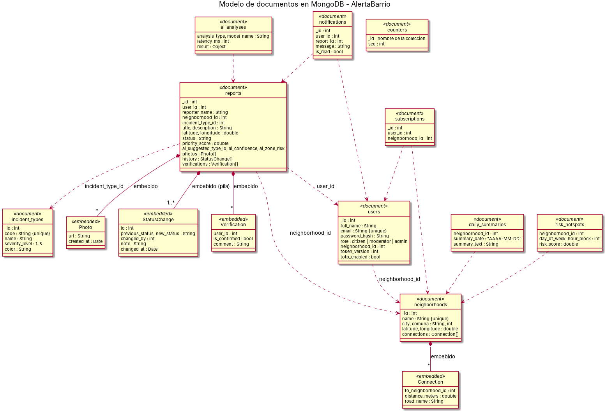

# AlertaBarrio · Base de datos (MongoDB)

**MongoDB 7.** Local con Docker (`docker compose up mongodb`) y en producción con **MongoDB Atlas** (clúster M0 gratis). El backend se conecta con la variable `MONGODB_URI`.

## Cómo pasamos el modelo relacional a documentos

Las 14 tablas que teníamos en PostgreSQL se convirtieron en **9 colecciones** (+ `counters`). La regla sale del diagrama de clases:

| Relación en el diagrama | Cómo se guarda en MongoDB | Ejemplo en AlertaBarrio |
|-------------------------|---------------------------|-------------------------|
| **Composición** (solo existe dentro del otro) | **Documento embebido** | `photos`, `history` y `verifications` van dentro del reporte; las vías (`connections`) van dentro del barrio de origen |
| **Asociación** (los dos tienen vida propia) | **Referencia por id** (+ copia del nombre si se muestra mucho) | El reporte guarda `user_id`, `neighborhood_id`, `incident_type_id` y una copia de `reporter_name` |
| **Rol del usuario** | **Un campo** en la misma colección | `role: "citizen" \| "moderator" \| "admin"` en `users` (antes tabla `roles`) |

## Colecciones

| Colección | Clase | Qué guarda | Antes (PostgreSQL) |
|-----------|-------|------------|--------------------|
| `users` | `User` | Vecinos, moderadores y administradores (clave con bcrypt) | `users` + `roles` |
| `neighborhoods` | `Neighborhood` | Barrios de Pasto (vértices del grafo) **con sus vías embebidas** (aristas) | `neighborhoods` + `neighborhood_connections` |
| `incident_types` | `IncidentType` | Tipos de incidente con gravedad 1–5 y color | `incident_types` |
| `reports` | `Report` | El reporte **con fotos, historial de estados y confirmaciones embebidos** | `reports` + `report_photos` + `report_status_history` + `report_verifications` |
| `subscriptions` | `Subscription` | Vecino ↔ barrio que sigue | `subscriptions` |
| `notifications` | `Notification` | Notificaciones entregadas (salen de la cola FIFO) | `notifications` |
| `ai_analyses` | `AIAnalysis` | Bitácora de cada llamada a la IA: modelo, latencia, resultado | `ai_analyses` |
| `daily_summaries` | `DailySummary` | Resumen diario por barrio | `daily_summaries` |
| `risk_hotspots` | `RiskHotspot` | Riesgo por barrio, día y franja horaria (mapa de calor) | `risk_hotspots` |
| `counters` | — | Último id usado por colección (ids enteros) | secuencias `SERIAL` |

## Decisiones

- **Ids enteros, no ObjectId.** Mongo genera ids largos (`6730f1c2a9e4...`), pero el frontend, las estructuras de datos (tabla hash, AVL, grafo) y las URLs usan números. Por eso cada colección tiene un contador en `counters` que se incrementa de forma atómica con `$inc` (`app/database.py: next_id`). Así el frontend no cambió nada.
- **Índices** (`app/database.py: ensure_indexes`): `users.email` y `neighborhoods.name` únicos, `(user_id, neighborhood_id)` único en `subscriptions`, y `status`, `neighborhood_id`, `created_at` en `reports`.
- **Sin guardado automático.** En SQLAlchemy cambiar un objeto y hacer `commit()` lo guardaba. En Mongo hay que llamar `save()` o hacer un `update_one`.
- **Cambios atómicos en el reporte.** Un cambio de estado hace un solo `update_one` con `$set` (estado) + `$push` (historial). Confirmar una alerta hace `$push` solo si el vecino no está ya en `verifications`, así nadie confirma dos veces.
- **Catálogos en memoria.** Barrios y tipos de incidente casi no cambian, así que se leen una vez y quedan en memoria (`models.catalog`) para mostrar nombres sin consultar Mongo en cada reporte.

## Ejemplos de documentos

- [`ejemplo_reporte.json`](ejemplo_reporte.json): reporte verificado con su historial (la pila) y dos confirmaciones.
- [`ejemplo_barrio.json`](ejemplo_barrio.json): barrio con sus vías embebidas.
- [`ejemplo_usuario.json`](ejemplo_usuario.json): usuario con su rol.

## Datos de ejemplo

El backend crea los índices y carga los datos solo al arrancar si `users` está vacía (`SEED_ON_STARTUP=true`): 338 barrios de las 12 comunas de Pasto, 8 tipos de incidente, 8 usuarios y unos 150 reportes. Contraseña demo: `Alerta2026*`.

Carga manual: `python -m app.seed`

## Ver los datos

- **mongo-express:** `docker compose --profile tools up mongo-express` y abrir http://localhost:8081
- **MongoDB Compass:** conectarse a `mongodb://localhost:27017` o a la URI de Atlas.
