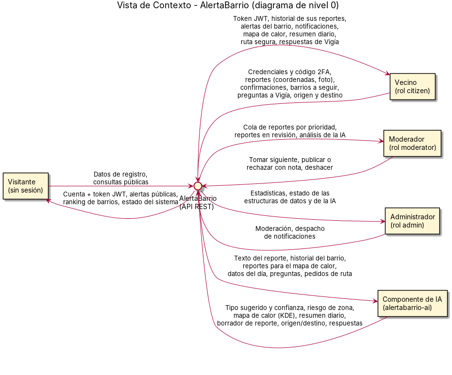
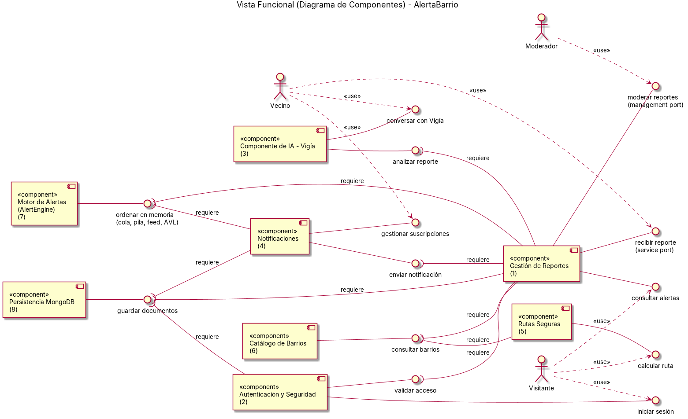
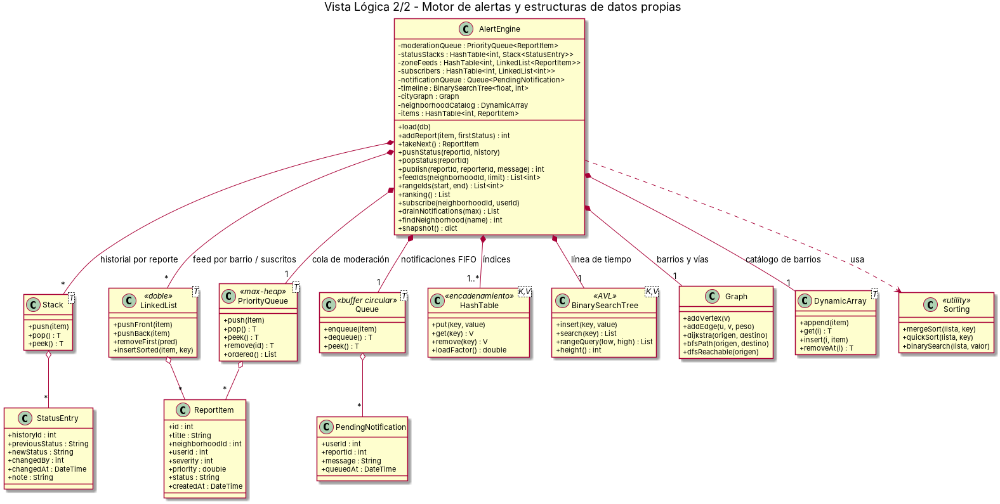
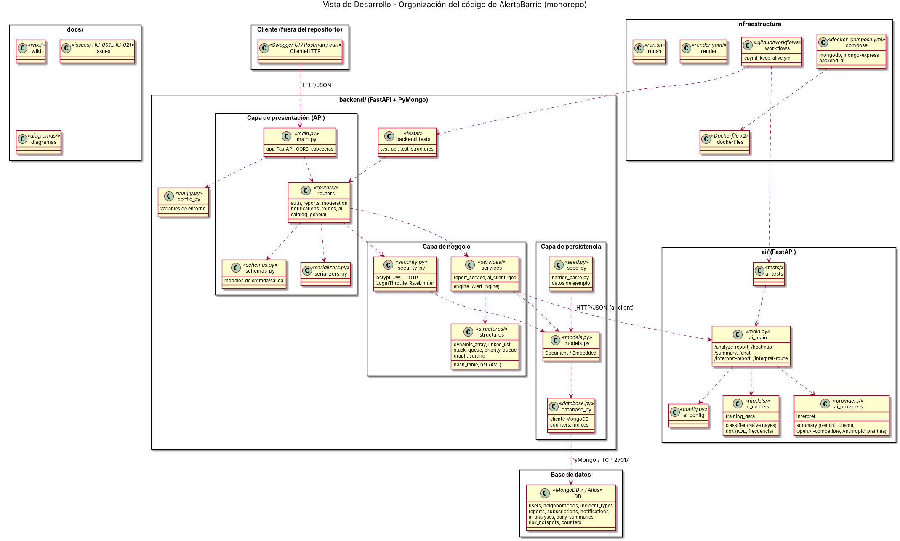

# 06 Arquitectura 4+1 Vistas

La arquitectura de AlertaBarrio se documenta con el modelo de **4+1 vistas** de Kruchten. Los diagramas se elaboran en **Visual Paradigm** (el código PlantUML de referencia está en `docs/diagramas`). La base de datos es **MongoDB**; el modelo de documentos completo está en `backend/database/README.md`.

> **Imágenes:** en Visual Paradigm usa *Project > Export > Diagrams as Image*. Luego edita esta página y arrastra cada imagen donde dice 📷.

---

## 1. Vista de Contexto

AlertaBarrio como caja negra y los flujos de información con su entorno.

| Actor / sistema externo | Hacia AlertaBarrio | Desde AlertaBarrio |
|-------------------------|--------------------|--------------------|
| Vecinos (desde un cliente HTTP) | Reportes con coordenadas, confirmaciones, barrios a seguir, preguntas a Vigía | Alertas del barrio, notificaciones, mapa de calor, ruta segura |
| Moderadores / Administradores | Publicar, rechazar y deshacer | Cola de reportes por prioridad, estadísticas |
| Componente de IA | Clasificación, riesgo de zona, mapa de calor, resumen, respuestas | Texto del reporte, historial del barrio, preguntas |

---

## 2. Vista Funcional

| Nº | Componente | Responsabilidad | Interfaz que ofrece |
|----|------------|-----------------|---------------------|
| 1 | Gestión de Reportes | Recibir reportes, cola de prioridad, cambios de estado, feed y confirmaciones | recibir reporte (puerto de servicio); moderar reportes (puerto de gestión) |
| 2 | Autenticación y Seguridad | Registro, JWT, roles, bloqueo por intentos, 2FA | validar acceso |
| 3 | Componente de IA (Vigía) | Clasificar, riesgo de zona, mapa de calor, resumen, borrador y chat | analizar reporte |
| 4 | Notificaciones | Suscripciones por barrio y cola FIFO de avisos | enviar notificación |
| 5 | Rutas Seguras | Grafo de barrios con Dijkstra y BFS | calcular ruta |

- **Puerto de servicio** de Gestión de Reportes: por ahí usa *validar acceso*, *analizar reporte* y *enviar notificación*.
- **Puerto de gestión:** lo usa el Moderador («use») para *moderar reportes*.

---

## 3. Vista Lógica

Diagrama de clases del dominio. Cada clase lleva el estereotipo **«document»** (tiene colección propia en MongoDB) o **«embedded»** (se guarda dentro de otro documento).

| Clase | Estereotipo (colección) | Atributos principales | Métodos / comportamiento |
|-------|-------------------------|-----------------------|--------------------------|
| Usuario | «document» (`users`) | id, nombreCompleto, email, passwordHash, telefono, rol, activo, totpActivo | iniciarSesion(), cambiarPassword(), activar2FA() |
| Barrio | «document» (`neighborhoods`) | id, nombre, ciudad, comuna, latitud, longitud, vias[] | — |
| Via | «embedded» (en Barrio) | barrioDestinoId, distanciaMetros, nombreVia | — |
| TipoIncidente | «document» (`incident_types`) | codigo, nombre, gravedad (1–5), color | — |
| Reporte | «document» (`reports`) | id, titulo, descripcion, latitud, longitud, direccion, fechaOcurrencia, estado, prioridad, confianzaIA, riesgoZonaIA, nombreVecino | cambiarEstado(), deshacer(), verificar() |
| FotoReporte | «embedded» (en Reporte) | url, fecha | — |
| CambioEstado | «embedded» (en Reporte) | id, estadoAnterior, estadoNuevo, nota, fecha | — |
| Verificacion | «embedded» (en Reporte) | usuarioId, confirmado, comentario | — |
| Suscripcion | «document» (`subscriptions`) | usuarioId, barrioId, fecha | — |
| Notificacion | «document» (`notifications`) | mensaje, leida, fecha | marcarLeida() |
| AnalisisIA | «document» (`ai_analyses`) | tipo, modelo, latenciaMs, resultado | — |
| ResumenDiario | «document» (`daily_summaries`) | fecha, texto, cantidadReportes, modelo | — |
| ZonaRiesgo | «document» (`risk_hotspots`) | diaSemana, franjaHoraria, riesgo | — |

**Cómo se pasaron las relaciones a MongoDB:**

| Relación en el diagrama | En MongoDB | Ejemplo |
|-------------------------|------------|---------|
| **Composición** (rombo relleno) | Documento **embebido** | *Reporte* contiene *FotoReporte*, *CambioEstado* (la pila de estados) y *Verificacion*; *Barrio* contiene sus *Via* |
| **Asociación** | **Referencia por id** (+ copia del nombre si se muestra mucho) | *Reporte* guarda `user_id`, `neighborhood_id`, `incident_type_id` y `reporter_name` |
| **Rol** | Un campo con valor fijo | `rol`: citizen, moderator o admin (antes una tabla aparte) |

- Los **ids son enteros** (1, 2, 3…), generados con la colección `counters`, para no cambiar las URLs de la API ni las estructuras de datos.
- Las clases embebidas no tienen colección ni id propio (salvo *CambioEstado*, que guarda un id para poder deshacer exactamente ese cambio).

**Motor de alertas:** al arrancar, el backend carga los datos en `AlertEngine`, que usa las estructuras propias (heap, pila, cola, lista enlazada, tabla hash, AVL, grafo y arreglo dinámico).

---

## 4. Vista de Desarrollo

| Capa / repositorio | Módulos |
|--------------------|---------|
| Interfaz — API REST | Swagger UI generado por FastAPI en `/docs`; lo consumen Postman, `curl` o cualquier cliente futuro |
| Lógica de negocio — `alertabarrio-backend/app` | `main.py`, `routers/` (auth, reports, moderation, notifications, routes, ai, catalog, general), `services/` (engine, report_service, ai_client, geo), `security.py`, `schemas.py` |
| Estructuras de datos — `app/structures` | dynamic_array, linked_list, stack, queue, priority_queue, hash_table, bst (AVL), graph, sorting |
| Persistencia | `models.py` (documentos «document» / «embedded»), `database.py` (PyMongo, contadores de ids e índices), `seed.py` → **MongoDB 7** (local con Docker, producción en MongoDB Atlas) |
| Servicio externo — `alertabarrio-ai` | API de IA (clasificador, riesgo, KDE, resúmenes) |

Los clientes solo hablan con el backend por HTTP/JSON. Los routers delegan en `services`, que usan `structures` y `models`. Solo `database.py` y `models.py` hablan con MongoDB, y solo `ai_client` habla con el componente de IA.

---

## 5. Vista de Despliegue (adicional)

| Nodo | Ambiente | Artefacto | Conexión |
|------|----------|-----------|----------|
| Cliente | Navegador (Swagger UI), Postman o `curl` | — | HTTPS/JSON → Render |
| Render — servicio web | Docker, Python 3.11 | `alertabarrio-backend` (FastAPI + uvicorn) | HTTP/JSON → IA · MongoDB / TCP 27017 (TLS) → Atlas |
| Render — servicio web | Docker, Python 3.11 | `alertabarrio-ai` (FastAPI) | — |
| MongoDB Atlas — clúster M0 (AWS) | MongoDB 7 | 9 colecciones del sistema | — |

---

## +1. Escenarios

- **HU_005 / HU_007 — Reportar un incidente:** Vecino → `POST /api/v1/reports` → guarda en BD (created) → Componente de IA clasifica y calcula riesgo → se calcula la prioridad → entra a la cola de moderación.
- **HU_009 / HU_010 — Publicar una alerta:** Moderador → `POST /api/v1/moderation/next` → toma el reporte más grave del heap → publica → feed del barrio + cola de notificaciones → vecinos suscritos.
- **HU_014 — Confirmar una alerta:** Vecino → `POST /api/v1/reports/{id}/verify` → `$push` atómico a `reports.verifications` solo si el vecino no estaba → con 2 confirmaciones pasa a *verified*.
- **HU_020 — Ruta segura:** Vecino → `GET /api/v1/routes/safe` → grafo de barrios + Dijkstra con castigo por alertas.

---

[← 05 Requisitos del sistema](05-Requisitos-del-sistema) | [07 Historias de Usuario →](07-Historias-de-Usuario)
