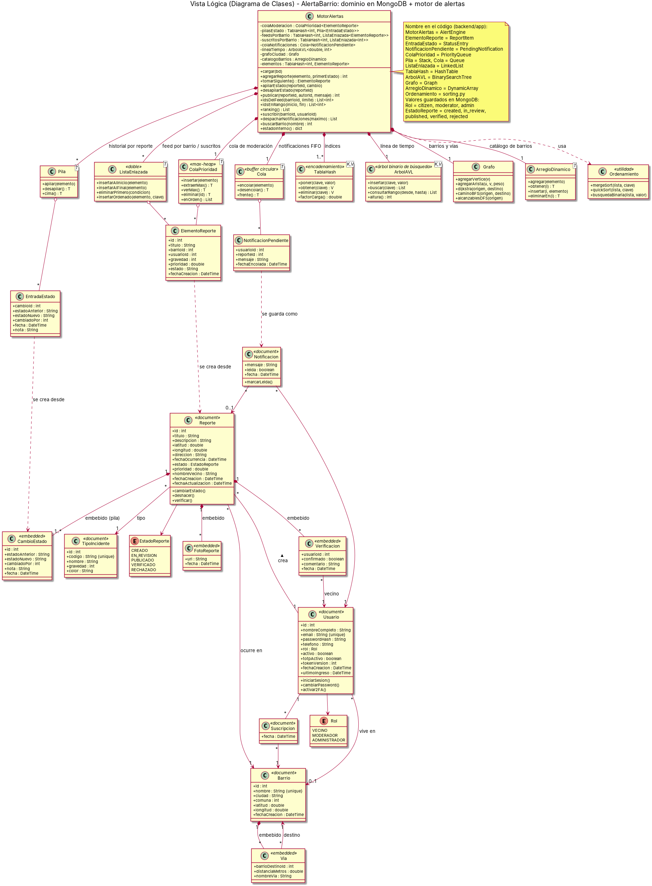
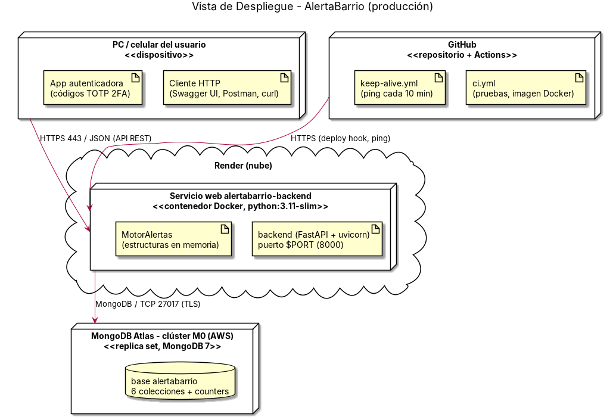

# 06 Arquitectura 4+1 Vistas

La arquitectura de AlertaBarrio se documenta con el modelo de **4+1 vistas** de Kruchten. Los diagramas se elaboran en **Visual Paradigm** (el código PlantUML de referencia está en `docs/diagramas`). La base de datos es **MongoDB**; el modelo de documentos completo está en `backend/database/README.md`.

> **Imágenes:** en Visual Paradigm usa *Project > Export > Diagrams as Image*. Luego edita esta página y arrastra cada imagen donde dice 📷.

---

## 1. Vista de Contexto

AlertaBarrio como caja negra y los flujos de información con su entorno.

| Actor | Hacia AlertaBarrio | Desde AlertaBarrio |
|-------|--------------------|--------------------|
| Visitante (sin sesión) | Datos de registro, consultas públicas | Cuenta + token JWT, alertas públicas, ranking de barrios, ruta segura, estado del sistema |
| Vecino (rol citizen) | Credenciales y código 2FA, reportes con coordenadas y foto, confirmaciones, barrios a seguir, origen y destino | Token JWT, historial de sus reportes, posición en la cola, alertas del barrio, notificaciones, ruta segura |
| Moderador (rol moderator) | Tomar siguiente, publicar o rechazar con nota, deshacer | Cola de reportes por prioridad, reportes en revisión |
| Administrador (rol admin) | Moderación, despacho de notificaciones | Estadísticas y estado de las estructuras de datos |

Todos los actores llegan a AlertaBarrio desde un cliente HTTP (Swagger UI, Postman o `curl`).

---

## 2. Vista Funcional

| Nº | Componente | Responsabilidad | Interfaz que ofrece |
|----|------------|-----------------|---------------------|
| 1 | Gestión de Reportes | Recibir reportes, cambios de estado, feed y confirmaciones | recibir reporte (puerto de servicio), consultar alertas, moderar reportes (puerto de gestión) |
| 2 | Autenticación y Seguridad | Registro, JWT, roles, bloqueo por intentos, 2FA | iniciar sesión, validar acceso |
| 3 | Notificaciones | Suscripciones por barrio y cola FIFO de avisos | enviar notificación, gestionar suscripciones |
| 4 | Rutas Seguras | Grafo de barrios con Dijkstra y BFS | calcular ruta |
| 5 | Catálogo de Barrios | Barrios, tipos de incidente, búsqueda binaria, barrio más cercano y ranking | consultar barrios |
| 6 | Motor de Alertas | Estructuras en memoria: cola de prioridad, pilas, feeds, AVL, grafo | ordenar en memoria |
| 7 | Persistencia MongoDB | Guardar y leer documentos, ids con `counters`, índices | guardar documentos |

- **Gestión de Reportes requiere:** validar acceso, enviar notificación, consultar barrios, ordenar en memoria y guardar documentos.
- **Rutas Seguras requiere** consultar barrios; **Notificaciones** requiere ordenar en memoria y guardar documentos; **Autenticación** requiere guardar documentos.
- **Actores («use»):** Visitante → iniciar sesión, consultar alertas, calcular ruta; Vecino → recibir reporte, gestionar suscripciones; Moderador → moderar reportes (puerto de gestión).

---

## 3. Vista Lógica

Diagrama de clases con dos partes: abajo el **dominio** guardado en MongoDB y arriba el **motor de alertas** en memoria. Cada clase del dominio lleva el estereotipo **«document»** (tiene colección propia en MongoDB) o **«embedded»** (se guarda dentro de otro documento).

| Clase | Estereotipo (colección) | Atributos principales | Métodos / comportamiento |
|-------|-------------------------|-----------------------|--------------------------|
| Usuario | «document» (`users`) | id, nombreCompleto, email, passwordHash, telefono, rol, activo, totpActivo, tokenVersion, fechaCreacion, ultimoIngreso | iniciarSesion(), cambiarPassword(), activar2FA() |
| Barrio | «document» (`neighborhoods`) | id, nombre, ciudad, comuna, latitud, longitud, vias[] | — |
| Via | «embedded» (en Barrio) | barrioDestinoId, distanciaMetros, nombreVia | — |
| TipoIncidente | «document» (`incident_types`) | codigo, nombre, gravedad (1–5), color | — |
| Reporte | «document» (`reports`) | id, titulo, descripcion, latitud, longitud, direccion, fechaOcurrencia, estado, prioridad, nombreVecino, fechaCreacion, fechaActualizacion | cambiarEstado(), deshacer(), verificar() |
| FotoReporte | «embedded» (en Reporte) | url, fecha | — |
| CambioEstado | «embedded» (en Reporte) | id, estadoAnterior, estadoNuevo, cambiadoPor, nota, fecha | — |
| Verificacion | «embedded» (en Reporte) | usuarioId, confirmado, comentario, fecha | — |
| Suscripcion | «document» (`subscriptions`) | usuarioId, barrioId, fecha | — |
| Notificacion | «document» (`notifications`) | mensaje, leida, fecha | marcarLeida() |

**Cómo se pasaron las relaciones a MongoDB:**

| Relación en el diagrama | En MongoDB | Ejemplo |
|-------------------------|------------|---------|
| **Composición** (rombo relleno) | Documento **embebido** | *Reporte* contiene *FotoReporte*, *CambioEstado* (la pila de estados) y *Verificacion*; *Barrio* contiene sus *Via* |
| **Asociación** | **Referencia por id** (+ copia del nombre si se muestra mucho) | *Reporte* guarda `user_id`, `neighborhood_id`, `incident_type_id` y `reporter_name` |
| **Rol** | Un campo con valor fijo | `rol`: VECINO, MODERADOR o ADMINISTRADOR (en MongoDB: citizen, moderator, admin) |

- Los **ids son enteros** (1, 2, 3…), generados con la colección `counters`, para no cambiar las URLs de la API ni las estructuras de datos.
- Las clases embebidas no tienen colección ni id propio (salvo *CambioEstado*, que guarda un id para poder deshacer exactamente ese cambio).

**Motor de alertas (mismo diagrama, parte de arriba):** al arrancar, el backend carga los datos en *MotorAlertas* (`AlertEngine` en el código), que usa las estructuras propias: ColaPrioridad (heap), Pila, Cola, ListaEnlazada, TablaHash, ArbolAVL, Grafo y ArregloDinamico. *ElementoReporte* se crea desde *Reporte*, *EntradaEstado* desde *CambioEstado* y cada *NotificacionPendiente* se guarda como *Notificacion*. Los diagramas usan nombres en español; la nota del diagrama indica el nombre de cada clase en el código.

---

## 4. Vista de Desarrollo

| Paquete / capa | Módulos (nombre en el diagrama → archivo) |
|----------------|-------------------------------------------|
| Cliente (fuera del repositorio) | ClienteHTTP: Swagger UI en `/docs`, Postman o `curl` |
| `backend/` — Capa de presentación (API) | Aplicacion → `main.py`, Controladores → `routers/` (auth, reports, moderation, notifications, routes, catalog, general), Esquemas → `schemas.py`, Serializadores → `serializers.py` |
| `backend/` — Capa de negocio | Seguridad → `security.py`, Servicios → `services/` (engine = MotorAlertas, report_service, geo), EstructurasDeDatos → `structures/` |
| `backend/` — Capa de persistencia | Modelos → `models.py`, AccesoDatos → `database.py`, DatosIniciales → `seed.py` |
| `backend/` — transversales | Configuracion → `config.py`, PruebasBackend → `tests/` |
| Base de datos | **MongoDB 7** (local con Docker, producción en MongoDB Atlas): 6 colecciones + `counters` |
| Infraestructura | `docker-compose.yml`, `Dockerfile`, `.github/workflows` (ci, keep-alive), `render.yaml`, `run.sh` |
| `docs/` | wiki, historias de usuario (issues) y diagramas |

Los clientes solo hablan con el backend por HTTP/JSON. Los controladores delegan en los servicios, que usan las estructuras de datos y los modelos. Solo `database.py` y `models.py` hablan con MongoDB.

---

## 5. Vista de Despliegue (adicional)

| Nodo | Ambiente | Artefactos | Conexión |
|------|----------|------------|----------|
| PC / celular del usuario | Navegador (Swagger UI), Postman o `curl` | Cliente HTTP; app autenticadora (códigos TOTP) | HTTPS 443 / JSON → Render |
| Render — servicio web `alertabarrio-backend` | Contenedor Docker, `python:3.11-slim` | backend (FastAPI + uvicorn, puerto `$PORT`); MotorAlertas en memoria | MongoDB / TCP 27017 (TLS) → Atlas |
| MongoDB Atlas — clúster M0 (AWS) | Replica set, MongoDB 7 | base `alertabarrio`: 6 colecciones + `counters` | — |
| GitHub | Repositorio + Actions | `ci.yml` (pruebas e imagen Docker), `keep-alive.yml` (ping cada 10 min) | HTTPS → Render (deploy hook y ping) |

---

## +1. Escenarios

- **HU_005 — Reportar un incidente:** Vecino → `POST /api/v1/reports` → `report_service.create_report()` guarda en BD (created) → prioridad = gravedad × 20 (+5 con foto) → entra a la cola de prioridad de moderación.
- **HU_009 / HU_010 — Publicar una alerta:** Moderador → `POST /api/v1/moderation/next` → toma el reporte más grave del heap → publica → feed del barrio + cola de notificaciones → vecinos suscritos.
- **HU_014 — Confirmar una alerta:** Vecino → `POST /api/v1/reports/{id}/verify` → `$push` atómico a `reports.verifications` solo si el vecino no estaba → con 2 confirmaciones pasa a *verified*.
- **HU_020 — Ruta segura:** Vecino → `GET /api/v1/routes/safe` → grafo de barrios + Dijkstra con castigo por alertas.

---

[← 05 Requisitos del sistema](05-Requisitos-del-sistema) | [07 Historias de Usuario →](07-Historias-de-Usuario)
